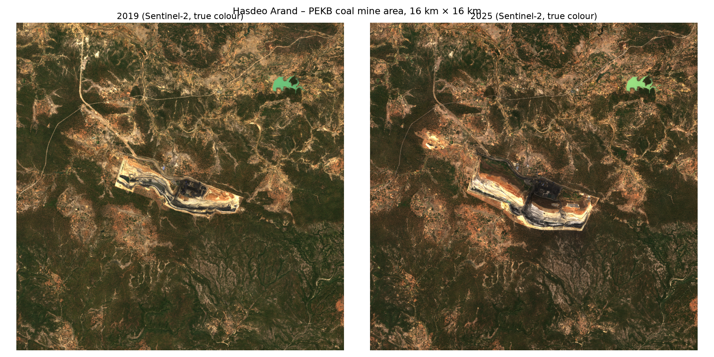
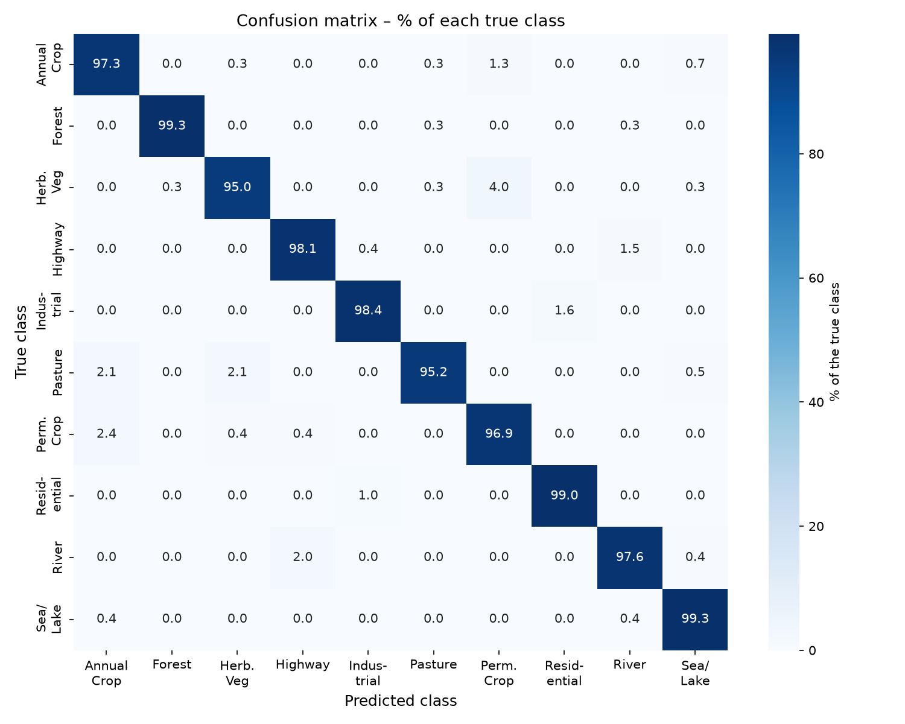
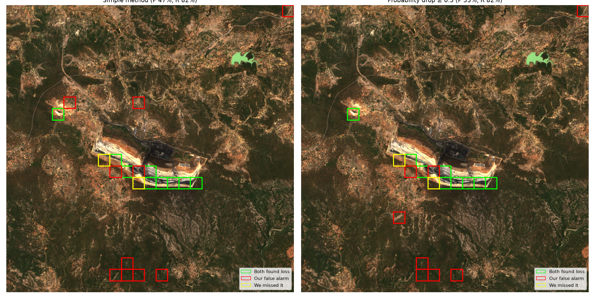
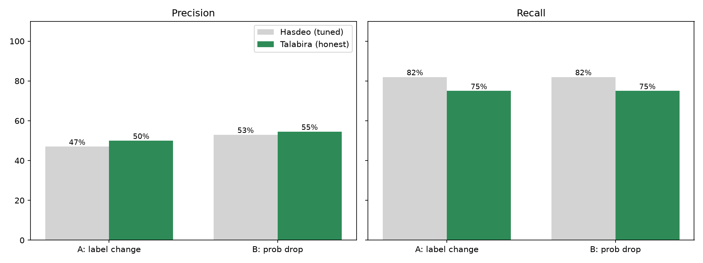

# Detecting deforestation from space at Hasdeo Arand

A ResNet50 land-cover classifier, trained on European satellite images (EuroSAT), applied to free Sentinel-2 imagery of two Indian coal-mining areas to find where forest disappeared between 2019 and 2025, then checked against Global Forest Watch.



## Why

Hasdeo Arand in Chhattisgarh is one of central India's largest dense forests, and parts of it are being cleared for open-pit coal mining. Monitoring this kind of change usually relies on large, specialised datasets. This project asks a simpler question: **can a lightweight model, trained only on European images, spot forest loss in India from free satellite data, and how far can you trust it?**

## How it works

1. **Train a land-cover classifier.** EuroSAT RGB has 27,000 Sentinel-2 image patches (64 × 64 px at 10 m/pixel, so 640 m × 640 m of ground each) in 10 classes. I used ResNet50 pretrained on ImageNet and replaced its last layer with a 10-class one. Training ran in two stages: first only the new layer (5 epochs, lr 0.001), then the whole network (5 epochs, lr 0.0001). The split was 80/10/10, with random flips for augmentation, batch size 64 and bfloat16 mixed precision, on an RTX 5060 laptop GPU (about 1 minute per epoch).
2. **Download real imagery.** Sentinel-2 L2A true-colour images of a 16 × 16 km area around the PEKB coal mine (22.838° N, 82.814° E), from 20 Feb 2019 and 8 Feb 2025. I used dry-season dates with under 5% cloud, both from the same satellite tile so the pixels line up exactly. The data comes from Element 84's free Earth Search catalogue.
3. **Map land cover.** Each image is cut into a 25 × 25 grid of patches (625 per year), and every patch is classified.
4. **Detect change**, two ways:
   - **A (label change):** a patch that was *Forest* in 2019 and anything else in 2025.
   - **B (probability drop):** a patch whose Forest probability fell by at least 0.5.
5. **Validate** against Global Forest Watch's tree-cover-loss data (Hansen et al., v1.13, 30 m). A patch counts as "really lost" if at least 10% of it lost trees in 2019–2024.
6. **Test on a second area with the settings fixed in advance:** the Talabira II & III coal mine in Odisha (21.735° N, 83.989° E), using images from 24 Mar 2019 and 25 Mar 2025.

## Results

### The classifier
| | |
|---|---|
| Test accuracy (2,700 unseen EuroSAT images) | **97.70%** |
| Macro-average F1 | 97.65% |
| Best class | Forest (F1 99.5%) |
| Worst class | Permanent Crop (F1 95.3%) |
| Most common mistake | Herbaceous Vegetation → Permanent Crop (12 images) |



### Deforestation, checked against Global Forest Watch

At Hasdeo, GFW recorded **2.09 km²** of tree-cover loss between the two images, almost all of it around the mine and mostly in 2023–2024.

| Area | Method | Precision | Recall | F1 |
|---|---|---|---|---|
| Hasdeo | A: label change | 47% | 82% | 60% |
| Hasdeo | B: probability drop ≥ 0.5 *(cut-off chosen here)* | 53% | 82% | 64% |
| Talabira | A: label change | 50% | 75% | 60% |
| Talabira | B: probability drop ≥ 0.5 *(fixed in advance)* | 55% | 75% | 63% |

*Precision: of the patches the model flagged, how many GFW also lost. Recall: of the patches GFW lost, how many the model found.*


*Green: both found loss. Red: our false alarm. Yellow: we missed it.*

**In short:** the model finds **about 3 in 4 real clearings**, but **about half of its alarms are false**. The results hold on a second area it was never tuned on.



## What I learned (limitations)

- **Domain shift is real.** EuroSAT forest is bluish temperate forest; Hasdeo is brown dry tropical forest. Average forest colour was about (39, 63, 75) vs (69, 65, 38) RGB. Re-colouring the Indian images to match EuroSAT made things *worse*: the model then called about half the area "Residential".
- **There's no "mine" class.** The model labelled the coal pit as Herbaceous Vegetation, SeaLake (the dark coal looks like water) or Highway. It can only answer with classes it was trained on.
- **Shadows and clouds cause false alarms.** Dark hill shadows at Hasdeo became "SeaLake", and small clouds and their shadows did the same at Talabira.
- **Confidence didn't transfer.** On EuroSAT, keeping only predictions with at least 90% confidence raised accuracy to 99.3%. In India, some false alarms were *highly* confident, while real mine-edge detections often weren't.
- **Big patches overestimate area.** A 640 m patch counts as fully lost even if only a corner was cleared. That gave 7.8 km² against GFW's 2.09 km² at Hasdeo (3.7×), although our correct patches contained 82% of GFW's loss. The method is good for *finding* clearing, poor for *measuring* it.
- **Don't grade on your own answer key.** The method-B cut-off was picked while looking at Hasdeo's GFW data, so I tested it unchanged on Talabira.
- **Even the reference has limits.** GFW only counts tree loss, so cleared scrub isn't flagged, and its loss years don't always match news reports.

## Notebooks

Run them in order. Each one explains every step in plain language, with lots of visuals.

| Notebook | What it does |
|---|---|
| [01_explore_data](notebooks/01_explore_data.ipynb) | Looks at EuroSAT: class counts, sample images, an image as numbers, why colour alone isn't enough |
| [02_train_model](notebooks/02_train_model.ipynb) | Transforms, splits, ResNet50 filters and feature maps, two-stage training, learning curves |
| [03_evaluate](notebooks/03_evaluate.ipynb) | Test accuracy, per-class scores, confusion matrix, confident mistakes, confidence analysis |
| [04_change_detection](notebooks/04_change_detection.ipynb) | Downloads Hasdeo imagery, land-cover maps for 2019 and 2025, the change map |
| [05_validate_gfw](notebooks/05_validate_gfw.ipynb) | Global Forest Watch comparison, precision/recall, the probability-drop method, area |
| [06_second_area_talabira](notebooks/06_second_area_talabira.ipynb) | The same fixed method on Talabira, Odisha |

## How to run it

Requirements: Python 3, an NVIDIA GPU (optional, but much faster), and about 3 GB of free disk space.

```bash
python -m venv .venv
.venv\Scripts\Activate.ps1          # Windows PowerShell; on Mac/Linux: source .venv/bin/activate
pip install torch torchvision --index-url https://download.pytorch.org/whl/cu128   # pick your CUDA version at pytorch.org
pip install jupyterlab ipykernel scikit-learn matplotlib seaborn pillow tqdm ipywidgets rasterio pystac-client
jupyter lab
```

1. Download **EuroSAT RGB** (for example from [Kaggle](https://www.kaggle.com/datasets/apollo2506/eurosat-dataset)) and extract it so the 10 class folders sit in `C:/data/EuroSAT`. Change `DATA_DIR` in the notebooks if you put it somewhere else.
2. Run notebooks 01 → 06. Notebook 02 saves the trained model to `models/resnet50_eurosat.pth`, which isn't in this repo because it's ~95 MB.

Notebooks 04–06 download satellite and GFW data on the fly; no accounts are needed.

## Next steps

- Use a **February 2026** image to capture 2025's clearing, GFW's biggest year at Hasdeo.
- Add a **mine / bare ground** class, and mask **clouds and shadows**.
- Use all **13 Sentinel-2 bands** instead of RGB, and **smaller patches** for better area estimates.
- Fine-tune on **Indian** imagery to reduce domain shift.

## Credits

- **EuroSAT:** Helber, P., Bischke, B., Dengel, A. and Borth, D. (2019). *IEEE JSTARS* 12(7), 2217–2226.
- **ResNet:** He, K., Zhang, X., Ren, S. and Sun, J. (2016). Deep Residual Learning for Image Recognition. *CVPR*.
- **Global Forest Watch / Global Forest Change:** Hansen, M. C. et al. (2013). *Science* 342(6160), 850–853.
- **Sentinel-2** imagery: ESA Copernicus, accessed via [Element 84 Earth Search](https://earth-search.aws.element84.com/v1).
- Mine locations: [Global Energy Monitor](https://www.gem.wiki/) wiki.

